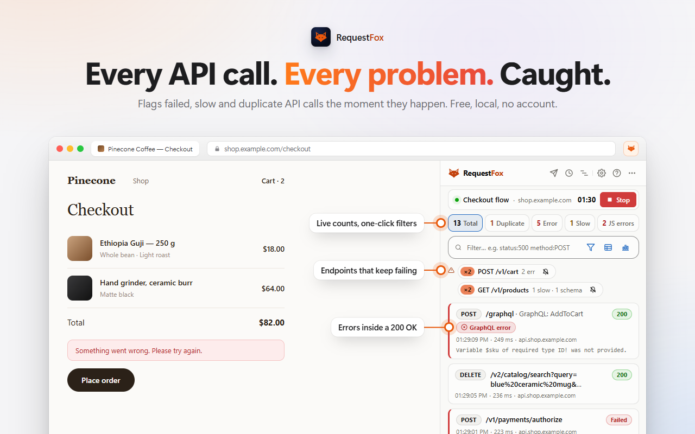
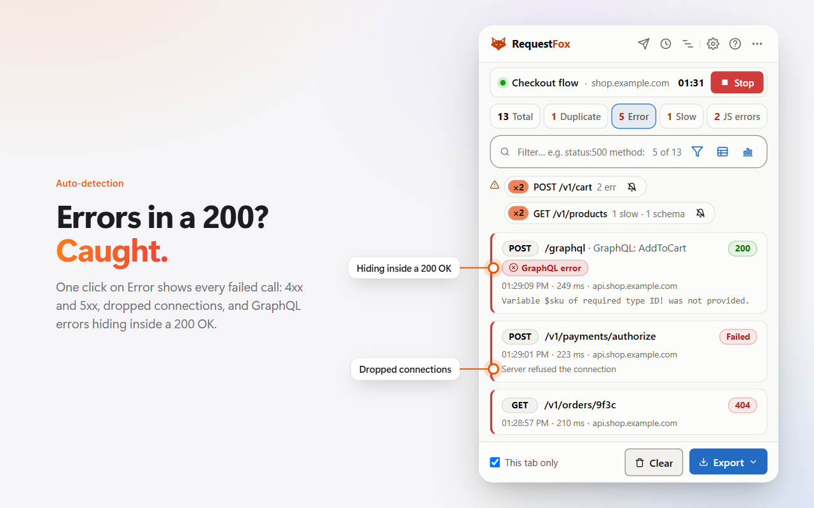

<h1 align="center">RequestFox</h1>

<b>Free API tester and network monitor for Chrome and Firefox.</b> 
It records the API calls your web app makes while you test it and flags the failed, slow and duplicate ones, tied to the click that caused them.

<a href="https://chromewebstore.google.com/detail/requestfox-network-qa-mon/lbhhldlnlgceobhpmpkljbefpiilhgmb">Add to Chrome</a> ·
<a href="https://addons.mozilla.org/firefox/addon/requestfox-network-qa-monitor/">Add to Firefox</a> ·
<a href="https://requestfox.accessisight.com/">Website</a> ·
<a href="https://requestfox.accessisight.com/guides.html">Guides</a> ·
<a href="../../issues">Report a bug</a>

## What it catches

While you click through your web app, RequestFox watches every API call the page makes (fetch, XHR, WebSocket and event streams) and flags the ones that go wrong:

- Failed calls, explained in plain words
- Errors hiding inside a 200 OK (GraphQL and JSON-RPC)
- 401s and 403s caused by an expired token
- N+1 bursts, duplicate calls and slow calls
- Responses that quietly changed shape

## What else it does

- Compose and send requests through the page you're testing, with its own cookies and session
- Mock any response in one click: real status, headers and body, or a failure
- See where the time went, phase by phase
- Copy any request as code in 15 languages
- Import collections from other API clients, OpenAPI specs, HAR, cURL and WSDL files
- Export HAR files, reports, end-to-end tests and load-test scripts

New in 2.4: up to five requests open at once in Compose, the log as a sortable table, a session Overview for bug reports, rule profiles and mock sets that stay on for the sites you name, and a stable code on every finding.

## Privacy

No account, no server, no telemetry: everything stays in your browser. RequestFox asks for access to a site only when you press Start on that tab. It contains no AI model and no AI code. Full policy: <https://requestfox.accessisight.com/privacy.html>

## Guides

- [How to record API calls in Chrome or Firefox](https://requestfox.accessisight.com/guide-record-api-calls.html)
- [GraphQL 200 OK with errors: how to spot and catch it](https://requestfox.accessisight.com/guide-graphql-errors-in-200.html)
- [Find duplicate and N+1 API calls in a web app](https://requestfox.accessisight.com/guide-duplicate-and-n-plus-one-api-calls.html)
- [Mock an API response in Chrome](https://requestfox.accessisight.com/guide-mock-api-response.html)
- [How to replay and edit an API request in Chrome](https://requestfox.accessisight.com/guide-replay-edit-request.html)
- [API testing in Firefox](https://requestfox.accessisight.com/guide-api-testing-firefox.html)
- [All questions and answers](https://requestfox.accessisight.com/faq.html)

## Bugs and ideas

Found a bug or want a feature? [Open an issue](../../issues/new/choose). Please don't paste tokens, cookies or private data. RequestFox redacts Authorization headers, cookies and secret-shaped fields in its views and exports by default, but check before you paste.

## About this repository

This repository holds RequestFox's documentation and its public issue tracker. RequestFox is free to use; its source code is not public. Made by Abhishek Johri.
